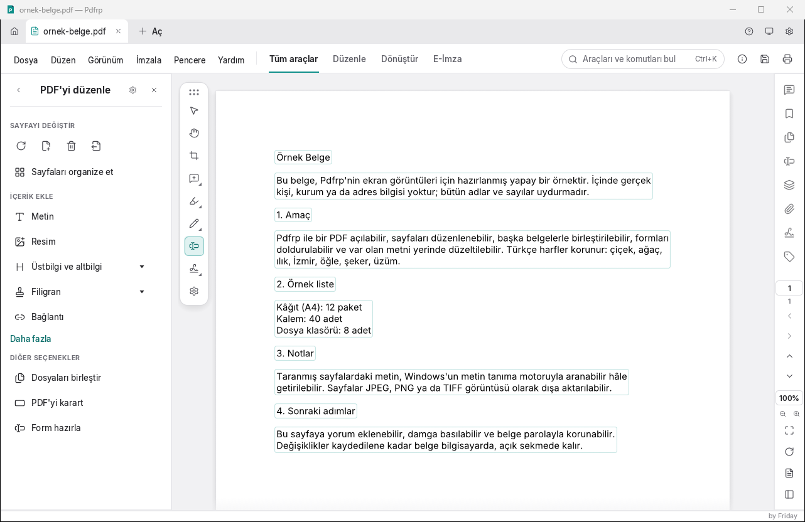
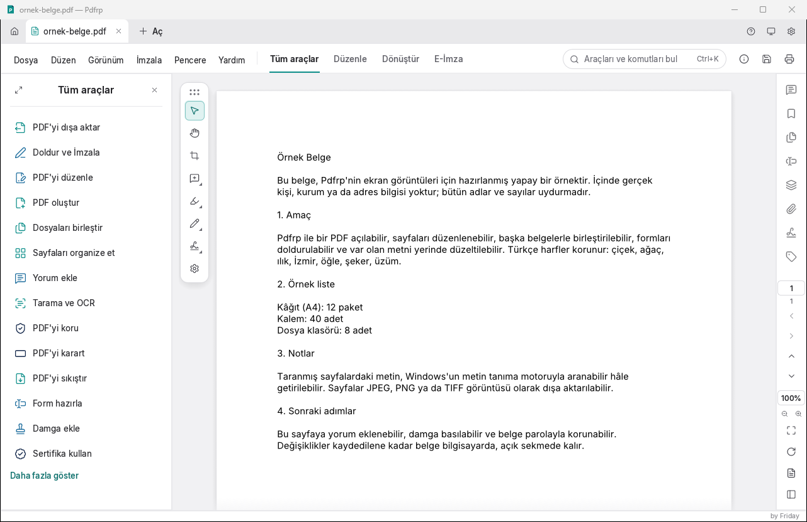
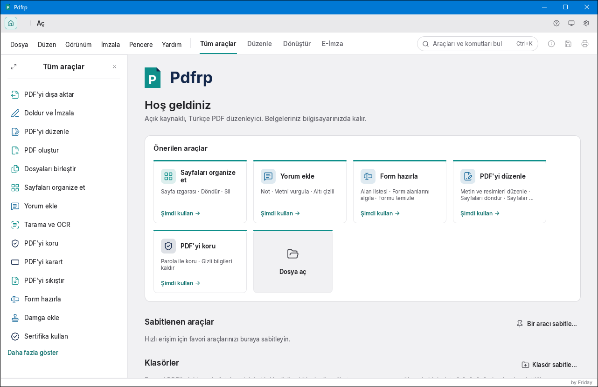
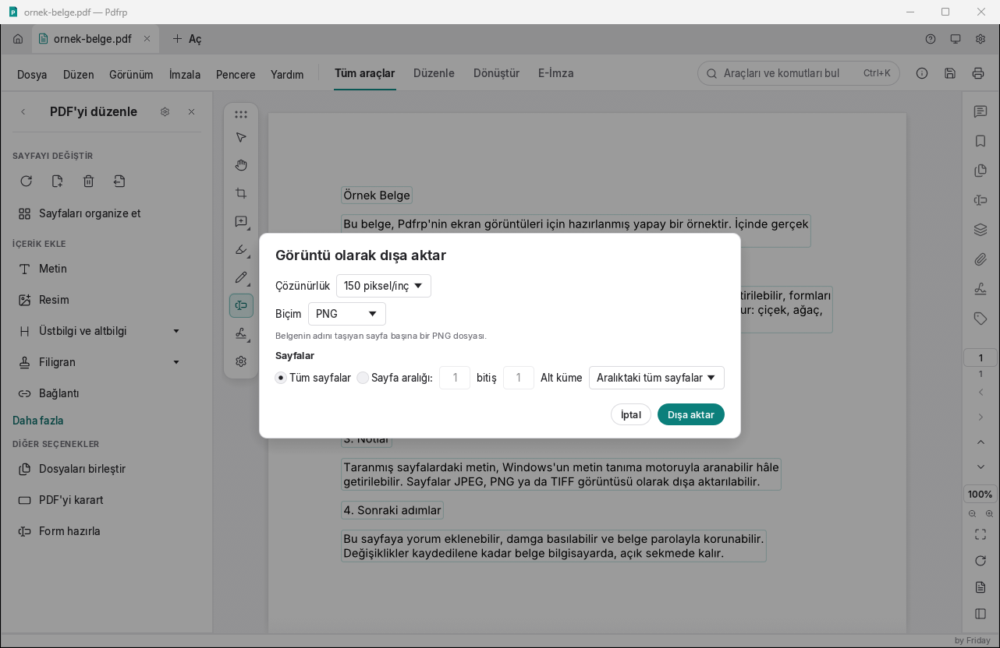
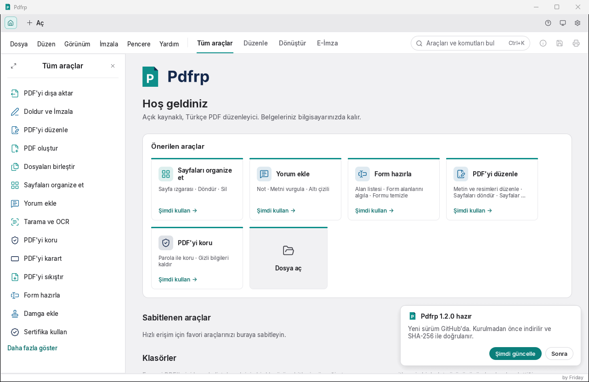

<p align="center">
  
</p>

<p align="center"><b>Windows için Türkçe, açık kaynak PDF görüntüleyici ve düzenleyici</b></p>

<p align="center">
  <a href="https://github.com/ceceys/pdfrp/releases/latest"></a>
  
  <a href="LICENSE"></a>
</p>

<h3 align="center">
  <a href="https://github.com/ceceys/pdfrp/releases/download/v1.1.0/Pdfrp.Kurulum.1.1.0.exe">⬇ Pdfrp'yi indir</a>
</h3>

<p align="center">
  Pdfrp 1.1.0 · Windows 10 ve 11, 64 bit · yaklaşık 26 MB<br>
  macOS ve Linux sürümleri de eklenecektir.<br>
  <a href="https://github.com/ceceys/pdfrp/releases">Tüm sürümler</a> · <a href="#kurulum">Kurulum</a> · <a href="#english">English</a>
</p>

# Pdfrp

Pdfrp, Windows için Türkçe arayüzlü, açık kaynak bir PDF görüntüleyici ve düzenleyicidir.
PDF okuma, yorumlama, form doldurma ve imzalama, sayfa düzenleme, birleştirme ve bölme, metin ve
resim düzenleme, karartma, parola koruması ve Türkçe metin tanıma yapar. Belgeler bilgisayarda
kalır: program hesap istemez, kullanım verisi göndermez; internete yalnız aşağıdaki güncelleme
denetimi için bağlanır. Programın adı “Pdf For Friday” ifadesinden gelir.

Araç düzeni, masaüstü PDF programlarına alışık kullanıcıların yadırgamayacağı biçimde kuruldu: solda araçlar, üstte sekmeler, sağda panel.

<p align="center">
  
</p>

## Öne çıkan özellikler

- **Türkçe arayüz:** menüler, araçlar ve iletiler Türkçe.
- **Türkçe metin tanıma (OCR):** taranmış sayfalar Windows'un kendi metin tanıma motoruyla
  aranabilir ve kopyalanabilir metne dönüşür (Windows'ta Türkçe metin tanıma özelliği yüklüyse).
- **Word, Excel ve PowerPoint dosyalarından PDF'ye dönüştürme (bilgisayarda Microsoft Office kuruluysa).**
- **Gezgin'den:** dosyaya sağ tıklayıp "Pdfrp ile PDF'ye dönüştür" (Office belgeleri,
  resimler, metin) ya da birkaç dosyayı seçip "Pdfrp'de birleştir". Windows 11'de bu
  komutlar sağ tık menüsünde "Diğer seçenekleri göster" altındadır.
- **Görüntü olarak dışa aktarma:** sayfaları JPEG, PNG ya da TIFF olarak kaydetme.
- **Birleştirme ve sayfa düzenleme:** dosyaları birleştirme, sayfa ekleme, silme, döndürme,
  sıralama, ayırma ve bölme.
- **Formlar:** form doldurma ve form alanı hazırlama.
- **Damga ve yorum:** hazır ve özel damgalar, notlar, vurgulama, çizim.
- **Metin düzeltme:** PDF'teki var olan metni yerinde düzeltme (sınırlarıyla) ve yeni metin
  ekleme; Türkçe harfler korunur.

<p align="center">
  
  
</p>
<p align="center">
  
  
</p>

## Kurulum

1. Kurulum dosyasını indirin (Windows 10 ya da 11, 64 bit):
   [Pdfrp 1.1.0](https://github.com/ceceys/pdfrp/releases/download/v1.1.0/Pdfrp.Kurulum.1.1.0.exe).
   Bütün sürümler [Releases](https://github.com/ceceys/pdfrp/releases) sayfasındadır. Sürüm
   sayfasında `Pdfrp Kurulum X.Y.Z.exe` görünür; indirdiğiniz dosyanın adı
   `Pdfrp.Kurulum.X.Y.Z.exe` olabilir. Kurulu Pdfrp sonraki sürümleri kendisi bulur (aşağıda).
2. İsterseniz dosyayı aynı sürümdeki `SHA256SUMS.txt` ile doğrulayın: dosyanın bulunduğu klasörde
   PowerShell'de `Get-FileHash -Algorithm SHA256 '.\Pdfrp*Kurulum*X.Y.Z.exe'` komutunu çalıştırın
   (iki adı da bulur). Verdiği değer, listede `Pdfrp Kurulum X.Y.Z.exe` satırındaki değerle
   aynı olmalıdır (büyük-küçük harf farkı önemsizdir).
3. Kurulum dosyasını çalıştırın. Kurulum "tüm kullanıcılar" ya da "yalnız benim için" seçeneğini
   sorar; PDF dosyalarının varsayılan programını değiştirmez, Pdfrp'yi "Birlikte aç"
   listesine ekler.

Kurulum dosyası kod imzalı değildir; Windows SmartScreen ilk çalıştırmada "Windows bilgisayarınızı
korudu" uyarısı gösterebilir. Dosyayı yukarıdaki gibi doğruladıysanız "Ek bilgi" ve ardından
"Yine de çalıştır" ile devam edebilirsiniz.

## Güncelleme denetimi

Pdfrp, açılışta (günde en çok bir kez) ve Yardım menüsünden ("Güncellemeleri denetle…") istendiğinde yalnız GitHub'a bağlanıp bu deponun son sürüm numarasına bakar; bu istekte belge, dosya adı ya da kullanıcı bilgisi gönderilmez, yalnız program adı ve sürümü iletilir (GitHub, her web isteğinde olduğu gibi IP adresini görür); yeni sürüm siz onaylamadan indirilmez ve kurulmaz. Açılıştaki denetimi Tercihler > Genel ve Arayüz'den kapatabilirsiniz; Yardım menüsündeki denetim yalnız siz seçtiğinizde çalışır.

“Şimdi güncelle” dediğinizde Pdfrp kapanır ve yeni sürümün kurulum sihirbazı açılır; kurulumu oradan sürdürür ya da iptal edersiniz. İndirilen kurulum dosyası, çalıştırılmadan önce sürümdeki `SHA256SUMS.txt` ile doğrulanır; uymazsa silinir. Kurulum bitince Pdfrp sihirbazın son sayfasından yeniden açılır.

<p align="center">
  
</p>

## Kaynaktan derleme

Gerekenler:

- [Rust](https://www.rust-lang.org/) 1.95 ya da daha yenisi.
- Windows'ta bir C araç zinciri: MSVC (Visual Studio Build Tools, `x86_64-pc-windows-msvc`) ya da
  GNU (`x86_64-pc-windows-gnu` ve MinGW-w64 GCC).
- Kurulum dosyası için [Inno Setup 6](https://jrsoftware.org/isinfo.php).

```sh
cargo build --release --locked -p migez-pdf      # program: target/release/migez-pdf.exe
cargo run -p migez-pdf -- belge.pdf              # geliştirme derlemesiyle bir belge açar
cargo test -p migez-update                       # bir paketin sınamaları
```

Arayüz çevirileri depodaki `i18n/` klasöründen derlemeye gömülür; başka bir kopya
`MIGEZ_I18N_DIR` ortam değişkeniyle verilebilir. Sürüm derlemesinde `MIGEZ_I18N_REQUIRED=1`
çevirileri, `MIGEZ_REQUIRE_WINRES=1` exe simgesini ve sürüm bilgisini zorunlu kılar.

Kurulum dosyası (çıktı `setup\`):

```powershell
pwsh -NoProfile -File kurulum\lisans-listesi.ps1   # üçüncü taraf bileşenlerin lisans listesi
& "$env:LOCALAPPDATA\Programs\Inno Setup 6\ISCC.exe" kurulum\pdfrp.iss
```

`v*` biçiminde bir etiket gönderildiğinde `.github/workflows/release.yml` aynı adımları GitHub
Actions'ta çalıştırır ve sürümü kurulum dosyası ile `SHA256SUMS.txt` dosyasıyla yayımlar.
Geliştirme notları `docs/development.md` dosyasındadır.

## Lisans

Pdfrp'nin kaynak kodu MIT Lisansı ile sunulur (`LICENSE-MIT`). Pdfrp, MIT veya Apache-2.0 seçimli lisansla yayımlanmış açık kaynak bir PDF programının işlenmesidir; üst kaynağın adı, telif bildirimi ve yapılan değişikliklere ilişkin not `NOTICE` dosyasındadır. `licenses/LICENSE-APACHE-upstream.txt`, üst kaynağın ve bazı bileşenlerin seçimli lisans metni olarak depoda durur. Yazı tipleri, simgeler ve öteki varlıklar kendi lisanslarıyla dağıtılır; kaynakları ve lisansları `ATTRIBUTION.md` dosyasındadır.

Pdfrp adı ve logosu MIT lisansının kapsamında değildir; değiştirilmiş sürümlerde çıkarılır ya da değiştirilir (`assets/pdfrp/LICENSE.txt`).

Programa derlenen üçüncü taraf Rust bileşenlerinin lisansları kurulumdaki `lisanslar` klasöründe,
`ucuncu-taraf-lisanslar.html` dosyasındadır.

## English

Pdfrp is an open-source PDF viewer and editor for Windows with a Turkish interface. It reads,
annotates, fills and signs PDFs, organizes, combines and splits pages, edits text and images,
redacts, protects with passwords, turns scanned pages into searchable, copyable text with Windows'
own text recognition (when Windows' Turkish OCR feature is installed), converts Word, Excel and
PowerPoint files to PDF when Microsoft Office is installed, and exports pages as JPEG, PNG or TIFF.
The name comes from “Pdf For Friday”.

- **Download:** [Pdfrp 1.1.0 installer](https://github.com/ceceys/pdfrp/releases/download/v1.1.0/Pdfrp.Kurulum.1.1.0.exe)
  (Windows 10 or 11, 64-bit, about 26 MB). The installed app finds later versions by itself.
  macOS and Linux versions will be added.
- **Install:** all versions are on [Releases](https://github.com/ceceys/pdfrp/releases). The release page shows
  `Pdfrp Kurulum X.Y.Z.exe`; the file you download may be named
  `Pdfrp.Kurulum.X.Y.Z.exe`. To check it, run
  `Get-FileHash -Algorithm SHA256 '.\Pdfrp*Kurulum*X.Y.Z.exe'` in its folder (it finds either
  name); the value must match the line for `Pdfrp Kurulum X.Y.Z.exe` in the release's
  `SHA256SUMS.txt` (letter case aside). The installer is not code-signed.
- **Update check:** at start (at most once a day) and from Help ▸ Check for updates, the app asks
  GitHub only for this repository's latest release. The request carries the program's name and
  version only (GitHub sees the IP address, as with any web request). Nothing is downloaded or
  installed until you choose "Update now"; the download is checked against the release's
  SHA-256 before it runs. Choosing “Update now” closes Pdfrp and opens the new version's
  setup wizard, where you can go on or cancel. Preferences ▸ General & Interface turns the check at
  start off; Help ▸ Check for updates asks only when you choose it. The update notice pictured in
  the Turkish section is an example: the version it names has not been released.
- **Build:** `cargo build --release --locked -p migez-pdf` (Rust 1.95+); the installer with
  Inno Setup 6 (`kurulum\pdfrp.iss`).
- **License:** the source code is offered under the MIT License (`LICENSE-MIT`). Pdfrp is a
  derivative of an open-source PDF application released under MIT or Apache-2.0; its name,
  copyright notice and a note on the changes are in `NOTICE`. The Pdfrp name and logo are
  not covered by the MIT License; modified versions must remove or replace them
  (`assets/pdfrp/LICENSE.txt`).
- **Trademarks:** product and company names mentioned may be trademarks of their owners. Pdfrp
  is an independent project; it is not affiliated with, sponsored or endorsed by those companies.

## Markalar

Anılan ürün ve şirket adları sahiplerinin markaları olabilir. Pdfrp bağımsız bir projedir; bu şirketlerle bağlantılı değildir, onlarca desteklenmez ya da onaylanmaz.
